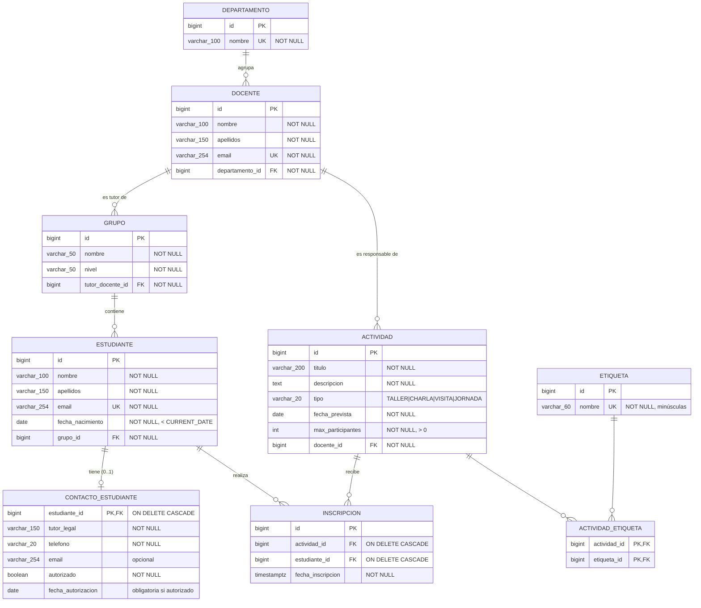

# Modelo de datos — CampusHub

La información se reparte entre dos motores:

- **PostgreSQL**: todo lo que tiene estructura fija y relaciones que hay que proteger
  (organización, estudiantes, actividades, inscripciones, fichas de contacto y etiquetas).
- **MongoDB**: los registros de seguimiento de las actividades, cuya estructura cambia según el
  tipo de actividad y puede evolucionar con el tiempo.

## 1. Modelo relacional (PostgreSQL)



### Relaciones

| Relación | Cardinalidad | Cómo se implementa |
|---|---|---|
| Departamento → Docente | 1:N | `docente.departamento_id` NOT NULL + FK |
| Docente → Grupo (tutor) | 1:N | `grupo.tutor_docente_id` NOT NULL + FK |
| Grupo → Estudiante | 1:N | `estudiante.grupo_id` NOT NULL + FK |
| Estudiante → Ficha de contacto | 1:0..1 | `contacto_estudiante.estudiante_id` es a la vez PK y FK (`@MapsId`) |
| Docente → Actividad (responsable) | 1:N | `actividad.docente_id` NOT NULL + FK |
| Actividad ↔ Estudiante | N:M con atributos | entidad `Inscripcion` (guarda la fecha de inscripción) |
| Actividad ↔ Etiqueta | N:M | tabla `actividad_etiqueta` con PK compuesta |

### Restricciones de integridad

| Regla | Mecanismo en PostgreSQL |
|---|---|
| Correo de estudiante único | `uk_estudiante_email` (UNIQUE) |
| Correo de docente único | `uk_docente_email` (UNIQUE) |
| Nombre de departamento único | `uk_departamento_nombre` (UNIQUE) |
| Nombre de etiqueta único | `uk_etiqueta_nombre` (UNIQUE) |
| Un estudiante no se inscribe dos veces en la misma actividad | `uk_inscripcion_actividad_estudiante` (UNIQUE sobre la pareja) |
| Una etiqueta no se asocia dos veces | PK compuesta `(actividad_id, etiqueta_id)` |
| Como máximo una ficha por estudiante | PK = FK `estudiante_id` |
| Capacidad mayor que cero | `ck_actividad_max_participantes` (`max_participantes > 0`) |
| Fecha de nacimiento anterior a hoy | `ck_estudiante_fecha_nacimiento` (`fecha_nacimiento < CURRENT_DATE`) |
| Tipo de actividad válido | CHECK generado por Hibernate para el `enum` |
| Textos no vacíos | CHECK `length(trim(...)) > 0` en nombres, apellidos, títulos, etc. |
| Formato mínimo de correo | CHECK `email LIKE '%_@_%'` |
| Si autoriza, debe constar la fecha | `ck_contacto_autorizacion` |
| Referencias válidas | Claves foráneas con nombre (`fk_...`) |
| No superar el aforo con peticiones simultáneas | `SELECT ... FOR UPDATE` sobre la actividad al inscribir (bloqueo pesimista) |

**Longitudes máximas razonadas**: nombre 100, apellidos 150 (suelen ser dos), correo 254 (máximo
del estándar RFC 5321), título 200, nombre de grupo/nivel 50, etiqueta 60, teléfono 20 (incluye
prefijo internacional). La descripción de la actividad usa `text` porque puede ser larga.

**Comportamiento de borrado**:

- `RESTRICT` (por defecto) en departamento, docente, grupo y etiqueta: no se puede borrar algo
  que otros datos están usando (perderíamos responsables de actividades o estudiantes sin grupo).
- `ON DELETE CASCADE` en la ficha de contacto y en las inscripciones: dependen totalmente del
  estudiante/actividad y no tienen sentido sin ellos.

### Índices

| Índice | Consulta a la que sirve |
|---|---|
| `uk_inscripcion_actividad_estudiante (actividad_id, estudiante_id)` | participantes de una actividad, plazas ocupadas, comprobar duplicados |
| `ix_inscripcion_estudiante (estudiante_id)` | historial de un estudiante (RF08) |
| `ix_actividad_etiqueta_etiqueta (etiqueta_id)` | actividades de una etiqueta (RF10); la PK ya cubre la búsqueda por actividad |
| `ix_actividad_docente (docente_id)` | actividades de un docente |
| `ix_actividad_fecha_prevista (fecha_prevista)` | ordenar/filtrar actividades por fecha |
| `ix_estudiante_grupo`, `ix_docente_departamento`, `ix_grupo_tutor` | claves foráneas (PostgreSQL no las indexa automáticamente) |
| UNIQUE de correos y nombres | además de garantizar unicidad, aceleran la búsqueda por correo/nombre |

## 2. Modelo documental (MongoDB)

Colección **`seguimientos`**: un documento por cada registro de seguimiento.

```json
{
  "_id": ObjectId("6737b1f2c4a1e23d9f0b1a2c"),
  "actividadId": NumberLong(3),
  "tipo": "VISITA",
  "datos": {
    "empresa": "Acme",
    "atendidoPor": ["Marta Ruiz", "Luis Pérez"],
    "observaciones": ["aprendizaje", "visita"],
    "incidencias": []
  },
  "creadoEn": ISODate("2026-11-15T19:50:00.123Z"),
  "versionEsquema": 1,
  "_class": "es.academia.campushub.document.SeguimientoDocument"
}
```

- **Campos comunes** (iguales para todos los tipos): `actividadId`, `tipo`, `creadoEn`, `versionEsquema`.
- **`datos`**: el objeto JSON recibido, guardado **tal cual** (mismo orden de claves, arrays,
  objetos anidados y tipos de número). Un taller puede guardar `lenguaje` y `ejercicios`, una
  charla `ponente` y `temas`, y mañana puede aparecer un tipo nuevo sin cambiar el código.
- **`versionEsquema`**: indica con qué versión del formato se escribió el documento, para poder
  leer registros antiguos si el formato de los campos comunes cambia en el futuro.
- **Referencia, no incrustación**: los seguimientos no se incrustan dentro de la actividad porque
  la actividad está en PostgreSQL y porque una actividad puede acumular muchos registros. Se
  guarda `actividadId` como referencia lógica al id de PostgreSQL.

### Validación mínima (`$jsonSchema`)

Se crea al arrancar la aplicación (`config/MongoSchemaInitializer`) con
`validationLevel: strict` y `validationAction: error`:

- obligatorios: `actividadId` (long/int ≥ 1), `tipo` (string de 1 a 50 caracteres),
  `datos` (objeto), `creadoEn` (fecha);
- **no** se valida el interior de `datos`: así se conserva la flexibilidad.

### Índices

| Índice | Consulta a la que sirve |
|---|---|
| `ix_seguimiento_actividad_fecha {actividadId: 1, creadoEn: 1}` | registros de una actividad en orden cronológico (detalle, RF06) |
| `ix_seguimiento_tipo {tipo: 1}` | filtrar registros por tipo de seguimiento |
